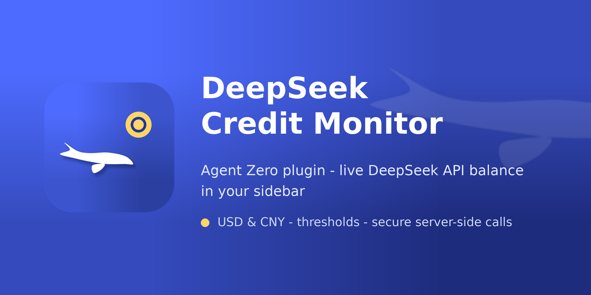

# DeepSeek Credit Monitor



An Agent Zero plugin that shows the current DeepSeek API account balance directly in the Agent Zero WebUI sidebar, with a details popover, low-balance alerts, and configurable refresh.

## About

DeepSeek Credit Monitor keeps you informed about your DeepSeek API account balance without leaving the Agent Zero WebUI. It queries the DeepSeek balance endpoint server-side, displays the latest balance in the sidebar, and warns you when the balance crosses configurable low or critical thresholds.

## Features

- **Sidebar indicator** showing `DeepSeek` plus the latest balance and a status chip (`OK`, `Low`, `Critical`, `Setup Required`, `Unavailable`), including a loading state and the last-update timestamp.
- **Details popover** that lists every returned currency (e.g. USD and CNY) with total, granted, and topped-up balances when provided, shows the API availability status, offers a manual **Refresh** button, and links to the plugin settings.
- **Low/critical threshold alerts** that fire only on status transitions — never on every poll.
- **Configurable refresh interval**: 30 / 60 / 120 / 300 / 600 seconds (default 60). The balance is refreshed on initial load and via manual refresh, and overlapping requests never occur.
- **Show/hide option** for the sidebar indicator.

## Installation

Requires Agent Zero with the plugins system.

Manual installation:

```bash
git clone https://github.com/jphermans/deepseek-credit-monitor /a0/usr/plugins/deepseek_credit_monitor
```

> The directory name must be `deepseek_credit_monitor`.

Then restart Agent Zero (or rescan the plugins) and enable the plugin in **Settings > Plugins**.

A Plugin Hub submission is planned.

## Configuration

| Setting | Default | Description |
|---|---|---|
| `deepseek_api_key` | `''` (empty) | **Required.** DeepSeek API key from https://platform.deepseek.com |
| `refresh_interval_seconds` | `60` | Refresh interval in seconds; allowed values: 30 / 60 / 120 / 300 / 600 |
| `balance_currency` | `USD` | Currency used for display priority and threshold evaluation |
| `low_balance_warning` | `5.0` | Low threshold in the configured currency |
| `critical_balance_warning` | `1.0` | Critical threshold in the configured currency |
| `show_balance_in_ui` | `true` | Show or hide the sidebar indicator |

## DeepSeek API

The plugin calls the DeepSeek balance endpoint:

```http
GET https://api.deepseek.com/user/balance
Authorization: Bearer <DEEPSEEK_API_KEY>
```

Example JSON response:

```json
{
  "is_available": true,
  "balance_infos": [
    {
      "currency": "CNY",
      "total_balance": "110.00",
      "granted_balance": "10.00",
      "topped_up_balance": "100.00"
    }
  ]
}
```

Response fields:

| Field | Type | Description |
|---|---|---|
| `is_available` | bool | Whether the DeepSeek API is currently available |
| `balance_infos` | array | One entry per currency; multiple currencies may be returned |
| `balance_infos[].currency` | string | Currency code (e.g. `USD`, `CNY`) |
| `balance_infos[].total_balance` | string | Total balance |
| `balance_infos[].granted_balance` | string | Granted balance; `"-"` when not applicable (displayed as n/a) |
| `balance_infos[].topped_up_balance` | string | Topped-up balance; `"-"` when not applicable (displayed as n/a) |

All balance values are strings.

## Security

The API key can be provided in two ways:

1. **Plugin settings** — stored server-side in user-space config and masked as `***` in the UI.
2. **Agent Zero secret store** — resolved under the name `DEEPSEEK_API_KEY` (`usr/secrets.env` or project secrets).

The key never reaches browser code, is never logged, and all DeepSeek API calls happen server-side in the framework runtime. Only the balance data the frontend needs is returned by the plugin API.

## Behavior details

### Currency handling

- Thresholds apply **only** to the configured display currency (`balance_currency`, default `USD`).
- Balances are never compared across currencies.
- If the configured currency is absent from the API response, the status shows as **Unknown** and threshold alerts are skipped, while other currency values are still displayed.

### Alerts

- Low and critical alerts fire only when the status **transitions** (e.g. `OK` to `Low`), never on every poll.

### Refresh behavior

- The first refresh happens on initial load; further refreshes follow the configured interval or the manual Refresh button.
- Requests never overlap.

## Troubleshooting

| Symptom | Cause / remedy |
|---|---|
| Status `Setup Required` | No API key configured |
| `401` / invalid key | Check the API key |
| `429` | Rate limited — increase the refresh interval |
| Timeout / network errors | The last known balance is kept and its age is shown |
| Status `Unavailable` | The API reports `is_available=false` |
| Stale value note | Shown when errors occur, indicating the displayed balance may be outdated |

## Uninstall

1. Remove the plugin via the Plugins UI (or delete the plugin directory).
2. Remove the `DEEPSEEK_API_KEY` secret if one was stored.

## Limitations

The plugin implements **balance monitoring only** — because only the balance endpoint is implemented, there is:

- no usage reporting,
- no per-key usage,
- no top-up functionality.

## License & credits

- **License:** MIT
- **Repository:** https://github.com/jphermans/deepseek-credit-monitor
- **Credits:** architecture and UX follow [jphermans/openrouter-credit-monitor](https://github.com/jphermans/openrouter-credit-monitor).
